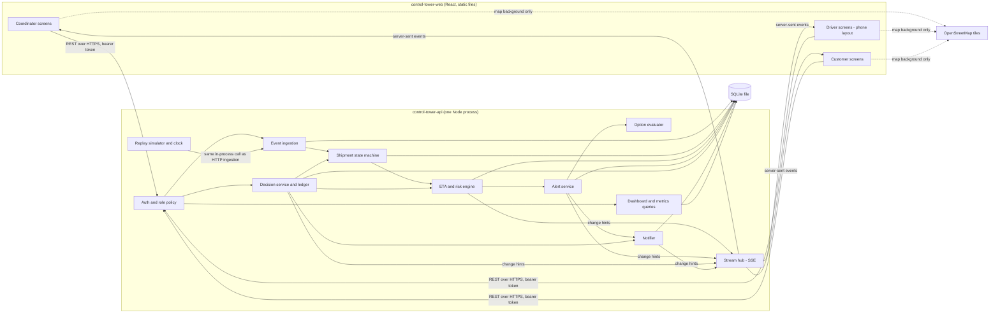
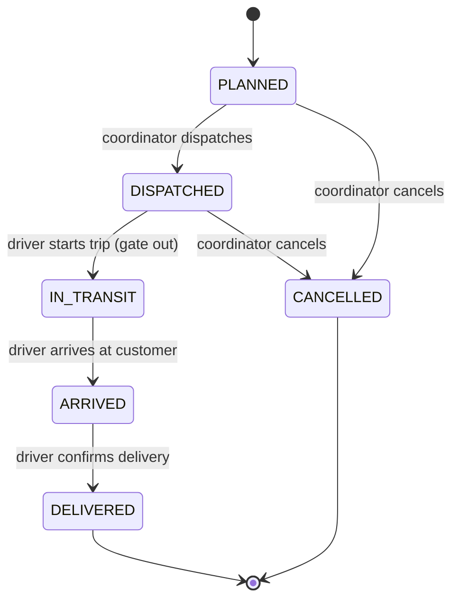

# DESIGN.md — Order-to-Delivery Control Tower (PS3)

LYB Mumbai Hackathon 2026, Round 2. Team of three. Status: **DRAFT for team review**.

All company, customer, transporter, driver, vehicle, order and cost data in this document is **fictional**, created for the hackathon. "Plant X" is the fictional company from the brief. Every number produced by the replay is a **simulation result**, not a real-world measurement.

References such as [p.7] are page numbers in `LYB_Mumbai_Hackathon_2026_Round2_Problem_Statements.pdf`, the authoritative brief.

---

## 0. Decision record

| # | Decision | Status | Chosen | Why (one line) |
|---|---|---|---|---|
| D1 | Time and venue | Approved | About 24 hours of build time; demo at the LYB office with reliable high-speed internet | Stated by the team lead |
| D2 | Platform and stack | Approved (stack delegated to architect) | Web app only, responsive for the driver's phone. TypeScript in both repositories | Brief asks for "a web app" [p.7]; one language lets three people and their coding agents read every file [p.9, p.12] |
| D3 | Primary workflow and signature feature | Approved | Prediction-first disruption flow, plus the decision ledger with counterfactual replay | Covers core 1–5 in one story and produces the required impact number [p.10] |
| D4 | ETA approach | Approved | Explainable segment-based rules engine; no learned model; no live traffic API | Section 6.1 compares seven strategies |
| D5 | Repositories and visibility | Approved | `control-tower-api` and `control-tower-web`, private, canonical docs in the API repository | Section 4.6 |

Assumption A1 (Open): "about 24 hours" is read as 24 wall-clock hours until the presentation, shared by three people. If it is 24 working hours each, the phases in `PHASES.md` scale up and the cut list is used less.

Gap in the brief: page 11 refers to slides showing each score level, but the PDF has 13 pages and contains no such slides. The rubric mapping in section 1.4 uses the criterion names and weights only.

---

## 1. Problem, users and success criteria

### 1.1 Problem

Plant X ships polymer in bulk to business customers. Customers and sales teams "often learn an order is late only after it already is" [p.7]. The objective is a web app that tracks orders from plant to customer, predicts delays, and gives every stakeholder a clear, shared view [p.7].

**Focus user:** the logistics coordinator. **Focus problem:** knowing which shipment will be late, why, and what can still be done about it, while there is still time to act. The brief asks each team to name its focus user and problem [p.3, p.12].

### 1.2 Users and what each needs to do

| Role | Needs to | Primary screen |
|---|---|---|
| Logistics coordinator (Plant X staff) | See which shipments need attention and why; compare feasible actions; approve one; see performance by route and transporter | Attention queue with map |
| Transporter / driver | See the assigned trip; advance milestones; report a disruption in a few taps on a phone; receive an approved route change | Trip screen (phone layout) |
| Customer (business buyer) | See only their own orders; see where the shipment is, the current ETA and the reason for any change; be told early about delay risk | My deliveries |

### 1.3 Core expectations mapped to design

Each row is one of the five core expectations on page 7.

| # | Core expectation [p.7] | Workflow | Component | Acceptance criterion | Demo moment (section 10.5) |
|---|---|---|---|---|---|
| C1 | Separate logins for customer, coordinator, transporter/driver | Each role signs in and lands on its own home screen | Auth service, role policy, three route groups in the web app | Three seeded users sign in; each sees a different home; a customer requesting another customer's shipment gets 404; a driver posting to a shipment not assigned to them gets 403 | 0:00–0:25 |
| C2 | Track orders and shipments on a map, with status milestones | Shipment moves along its route; milestones advance as the driver taps | Event ingestion, shipment state machine, map view, milestone timeline | A position event moves the marker within 2 s on all open role screens; milestone timeline shows each state with its timestamp | 0:25–0:50 |
| C3 | Predict an ETA and delay risk per shipment, and show the reason | Every applied event recalculates ETA, risk score and reason list | ETA engine, `eta_snapshots` | The worked example in section 6.6 reproduces exactly; every snapshot lists its contributing factors in minutes | 0:50–1:25 and 1:25–2:00 |
| C4 | Alert customer and coordinator on delay risk, with a suggested action such as reroute or split shipment | Risk crossing a threshold opens an alert; options are generated and ranked; coordinator approves; customer is notified | Alert service, option evaluator, decision service, notifier | MEDIUM alerts the coordinator; HIGH alerts coordinator and customer; each alert has at least one option and exactly one recommended option; approval changes the shipment and notifies customer and driver | 0:50–3:20 |
| C5 | Dashboard of on-time performance and delay causes by route and transporter | Coordinator opens the dashboard | Dashboard queries, charts | On-time % and delay-cause minutes shown grouped by route and by transporter; the demo shipment appears after delivery | 3:20–3:50 |

Bonus items on page 7 (truck slot booking, "Where is my order?" chatbot, invoice and proof-of-delivery upload/download) are optional and treated in section 2.3.

### 1.4 Judging rubric mapped to design [p.11]

| Criterion | Points | How the design addresses it |
|---|---|---|
| Problem understanding and user fit | 10 | One named focus user and problem; attention queue ordered by risk; customer told the reason, not just the time |
| Innovation and original thinking | 10 | Decision ledger with counterfactual replay: every approval stores what each option was predicted to do, then compares with what happened |
| Working prototype / functionality | 20 | All five core expectations run live on a deterministic replay with a one-call reset; thin path built first |
| Technical design and architecture | 10 | One diagram that matches the demo; one system of record; documented contracts; idempotent event ingestion |
| Feasibility and scalability | 10 | Built from boring parts; section 4.5 gives the measured point at which each part would need to change |
| Business / user value and impact | 15 | Warning lead time, delay avoided and on-time delivery calculated from the replay, with assumptions stated (section 10.3) |
| Responsible AI, security and data | 10 | No model decides anything; every suggestion needs coordinator approval; confidence shown; server-side scoping; AI use declared (section 9.6) |
| User experience and accessibility | 5 | Phone-first driver screen; risk never shown by colour alone; list alternative to the map; keyboard support |
| Presentation and demo | 5 | Timed four-minute script; rehearsed reset |
| Q&A and team understanding | 5 | Section 11 lists every design choice with the alternative rejected and why; no component the team cannot explain |

### 1.5 Success criteria for the prototype

1. The demo script in section 10.5 runs end to end three times in a row after `POST /demo/reset`, with identical numbers.
2. All acceptance criteria in section 1.3 pass.
3. The integration tests in section 10.2 pass.
4. Each team member can explain the ETA formula, the event rules and the access rules without notes [p.9, p.12].

---

## 2. Product direction and scope

### 2.1 Direction

An **exception-first control tower**. The coordinator does not watch a map waiting for trouble. The system ranks shipments by delay risk, states the reason in minutes, proposes feasible actions with their predicted outcomes, and records the human decision. The map and milestones are a shared view for all three roles; what each role can see and do differs.

### 2.2 Smallest complete prototype (must ship)

| Feature | User | Decision it helps | How we show it works |
|---|---|---|---|
| Role logins and scoped data | All | None directly; it makes the shared view safe | Three sign-ins; a cross-customer request is refused |
| Live map with milestones | All | "Where is it and what stage is it at?" | Marker moves; timeline advances when the driver taps |
| ETA, risk score and reasons | Coordinator, customer | "Will it be late, by how much, and why?" | ETA panel lists factors in minutes that sum to the ETA |
| Alerts with ranked options | Coordinator | "What can I still do, and which is best?" | Options table with projected arrival, lateness, extra distance and cost |
| Decision approval | Coordinator | "Do I approve this change?" | Approve reroute; driver gets the new route; customer gets the revised ETA |
| Infeasible and no-improvement handling | Coordinator | "What if nothing helps?" | Second shipment: reroute shown as unavailable with its reason; system recommends accepting the delay and notifying the customer |
| Performance dashboard | Coordinator | "Which routes and transporters cause delay?" | On-time % and delay-cause minutes by route and transporter |
| Demo replay and reset | Team | None; it makes the demo repeatable | One call restores the seed and restarts the scenario |

### 2.3 Optional features, ranked

Ranking uses judge-visible value, effort and integration risk.

| Rank | Feature | User | Decision it helps | Value | Effort | Risk | How we show it works | Verdict |
|---|---|---|---|---|---|---|---|---|
| 1 | **Decision ledger with counterfactual replay** | Coordinator; judges | "Was that decision right, and how much did it save?" | High: feeds impact (15 pts) and innovation (10 pts) | About 4 h, mostly backend | Medium: needs the simulator to run the unchosen branch | Ledger card after delivery: predicted vs actual arrival, and arrival had no action been taken | **Signature feature, in scope** |
| 2 | Proof of delivery upload and download (bonus [p.7]) | Driver, customer | "Has it been delivered and can I prove it?" | Medium | About 1.5 h | Low: isolated to the final milestone | Driver attaches a photo at delivery; customer downloads it | Build if phase 4 finishes on time |
| 3 | "Where is my order?" assistant (bonus [p.7]) | Customer | "What is happening with my order?" without reading the screen | Medium | About 2.5 h | Medium: only feature that may call a language model | Customer types a question; answer quotes the same ETA and reason as the screen | First to cut |

Truck slot booking at the plant gate (bonus [p.7]) is **not planned**. It is a separate scheduling workflow that never touches the delay flow, so it adds build time without strengthening the main story.

### 2.4 Out of scope

Real GPS hardware, live traffic feeds, order entry and pricing, email or SMS delivery, multi-stop trips, return logistics, a native mobile app (D2).

---

## 3. Evaluation of the candidate demo

The candidate from the team lead: a transporter reports a disruption; the ETA changes for an inspectable reason; the coordinator compares feasible actions and approves one; the customer receives the revised ETA; the prototype also shows what happens when the alternate route is unavailable.

| Check | Finding |
|---|---|
| Covers core 1–4 | Yes |
| Covers core 5 (dashboard) | No. Added as the closing beat |
| "Predict delays before they happen" [p.4, p.7] | Weak as written: a driver report is a reaction. Added an opening beat where the engine raises risk from slow progress before anyone reports anything |
| Fits four minutes [p.10] | Only on an accelerated, deterministic replay. Adopted |
| Unavailable alternate | Kept as a 35-second second beat on a second shipment, which also shows the no-improvement case |

**Adopted flow (approved under D3):** system flags risk from slow progress → driver's report confirms the cause → coordinator compares options and approves a reroute → customer and driver are notified → a second shipment shows a reroute that is not available → the dashboard and the decision ledger close the story.

---

## 4. Architecture and repository boundaries

### 4.1 System diagram

This is the diagram to show judges; it matches what the demo runs [p.10, p.12].



### 4.2 Components

| Component | Responsibility | Lives in |
|---|---|---|
| Web app | Three role areas; renders API data; never calculates ETA, risk or permissions | `control-tower-web` |
| Auth and role policy | Login, token check, per-request scope | API `src/auth` |
| Event ingestion | Validate, de-duplicate, order and store shipment events | API `src/events` |
| Shipment state machine | Allowed transitions; updates the shipment row | API `src/shipments` |
| ETA and risk engine | Pure function from shipment state to ETA snapshot | API `src/eta` |
| Alert service | Opens, escalates and resolves alerts from snapshots | API `src/alerts` |
| Option evaluator | Builds and ranks options using the ETA engine on hypothetical state | API `src/options` |
| Decision service and ledger | Applies an approved option; records predictions and outcomes | API `src/decisions` |
| Notifier | Writes in-app notifications; interface allows email or SMS later | API `src/notify` |
| Stream hub | Pushes change hints to connected browsers | API `src/stream` |
| Replay simulator and clock | Drives positions on a simulated clock; runs counterfactual branches | API `src/sim`, `fixtures/` |
| Dashboard and metrics | Aggregations over delivered shipments and decisions | API `src/dashboard` |

### 4.3 System of record

| Fact | System of record | Written by | Notes |
|---|---|---|---|
| Shipment status | `shipments.status` | State machine only, in the same database transaction that stores the triggering event | `shipment_events` is the append-only history; the row is the authority for "current" |
| ETA and delay risk | Latest row in `eta_snapshots`, referenced by `shipments.current_eta_snapshot_id` | ETA engine only | The web app displays it and never recomputes it |
| Promise to the customer | `orders.original_promised_by` (never changes) and `orders.agreed_delivery_by` (changes on an approved reschedule) | Decision service | On-time performance is always measured against the original promise |

### 4.4 Technology choices

Major choices are fixed by D2 and D4. The rest are reversible implementation choices recorded here so both repositories agree.

| Concern | Choice | Reason | Rejected alternative |
|---|---|---|---|
| Language | TypeScript, current Node LTS | One language across both repositories; API types generated for the web app | Python API: second language for no gain in this design |
| API framework | Fastify with Zod request and response schemas, serving `/openapi.json` | Schemas are the contract and the validation at once | Hand-written validation: drifts from the docs |
| Persistence | SQLite, one file, via `better-sqlite3`, plain SQL migrations | Zero setup; a reset is a file rewrite; one writer is enough at demo scale | PostgreSQL now: setup and hosting time with no judge-visible benefit. It is the production path (section 4.5) |
| Live updates | Server-sent events carrying change hints; client refetches over REST; falls back to polling every 3 s if the stream drops | REST stays the single source of data; stream failure degrades, it does not break | WebSockets: two-way channel not needed. Polling only: slower alerts in a 4-minute demo |
| Web framework | React with Vite, React Router, TanStack Query, Tailwind CSS | Static build; query cache makes "refetch on hint" one line | Next.js: server rendering adds deployment surface we do not use |
| Map | Leaflet with OpenStreetMap raster tiles; routes drawn from our own GeoJSON | No API key; routes and markers still draw if tiles fail | Google or Mapbox: keys, quotas, terms |
| Charts | Recharts | Simple bar charts | D3 by hand: time |
| Tests | Vitest in both repositories; one Playwright script for the demo path | Fast; same runner both sides | — |
| Message queue, cache, container orchestration | **None** | No requirement or measured constraint needs them at this scale | — |

Open O1: `better-sqlite3` needs a prebuilt binary for the developer's platform. If install fails on any machine, switch to Node's built-in `node:sqlite` module. Affects only `src/db`.

### 4.5 Scaling: what needs to scale independently

Nothing needs independent scaling for the prototype. One process serves three browsers. The table states when that stops being true, using a **fictional sizing assumption** of 500 trucks each sending one position every 30 seconds (about 17 events per second).

| Component | Prototype | Changes when | Production shape |
|---|---|---|---|
| Event ingestion | In-process | Position volume grows beyond what one writer handles, or devices need buffering | Separate stateless ingestion service writing to a queue; scales with truck count |
| ETA engine | Called inline per event | Recalculation latency delays ingestion | Workers consuming the queue; scale with event rate |
| Read API and dashboards | Same process | Many customers and coordinators browsing | Stateless API replicas behind a load balancer; read replica for dashboards |
| Stream hub | In-memory subscriber list | More than one API instance | Publish/subscribe channel between instances |
| Database | SQLite file | More than one API instance or concurrent writers | PostgreSQL with PostGIS for route geometry |

At 17 events per second a single PostgreSQL instance is sufficient, so the first production step is the database swap, not a streaming platform.

### 4.6 Repository map (D5, approved)

| Repository | Contents | Owner slot | Deploys as |
|---|---|---|---|
| `control-tower-api` | API, ETA engine, simulator, fixtures, migrations, tests, **canonical `DESIGN.md` and `PHASES.md` at the repository root**, `AI_USAGE.md` | Owner A (API), Owner C (simulator, fixtures, tests) | One Node web service |
| `control-tower-web` | React app, generated API types, UI tests; README links to the two canonical documents | Owner B | Static site |

Why two and not three: there are two deployables (a service and a static site) and two clear ownership areas. The simulator shares the API's clock and ingestion code path, so splitting it out would create a third deployment with no separate owner or scaling need.

Why the documents live in the API repository: it owns the contracts that the web app consumes, so the contract text and the contract code change in the same commit.

Visibility: **private**, with judges or organisers added on request. The trade-off is that private repositories cannot be browsed by judges without an invitation.

Branching (provisional): `main` is always runnable. Work happens on short-lived branches named `feat/<area>-<short-name>` and merges by pull request with one teammate's review. No branch protection is observable today because the organisation has no repositories.

### 4.7 Cross-repository dependency

The only dependency is the HTTP contract in section 5.

- The API serves `/openapi.json`, generated from its Zod schemas.
- The web repository runs `npm run sync:api`, which generates `src/api/types.gen.ts` from that file. The generated file is committed.
- Until the API endpoint exists, the web app uses a mock server built from the sample payloads in section 5.7. The samples in this document are the tie-breaker if code and document disagree during the build.

### 4.8 Local development

| Step | API | Web |
|---|---|---|
| Install | `npm install` | `npm install` |
| Configure | copy `.env.example` to `.env` | copy `.env.example` to `.env` |
| Run | `npm run dev` on port 4000 (migrates and seeds on first start) | `npm run dev` on port 5173, `VITE_API_URL=http://localhost:4000` |
| Test | `npm test` | `npm test` |
| Reset data | `npm run seed` or `POST /api/v1/demo/reset` | — |

API environment variables: `PORT`, `JWT_SECRET`, `CORS_ORIGINS`, `DATABASE_FILE`, `DEMO_MODE` (`true` enables the simulated clock and demo endpoints).

### 4.9 Deployment

The venue has reliable internet (D1), and the driver flow is best shown on a real phone, which needs a public URL.

| Part | Target | Notes |
|---|---|---|
| Web | Static hosting | Build output only; no secrets |
| API | One always-on Node instance with HTTPS | Exactly one instance, because SQLite and the in-memory stream hub are single-process. The database is reseeded on start, so an ephemeral disk is acceptable |
| Fallback | Both processes on the presenter's laptop; driver screen shown in the browser's phone-size view | Rehearsed once |

Open O2: hosting provider. Any provider that runs one persistent Node process and serves static files will do. It affects only the deploy task in phase 4. Confirm before T+16 that the chosen plan does not put the service to sleep during the session.

---

## 5. Domain model and interfaces

### 5.1 Conventions

- Base path `/api/v1`. JSON only.
- Timestamps are ISO 8601 in UTC with a `Z` suffix. The web app displays them in India Standard Time (UTC+5:30). Section 6.6 gives both.
- Identifiers are readable strings: `ORD-5001`, `SHP-1001`, `RTE-01`, `ALT-0001`, `OPS-0001`, `DEC-0001`. Client-generated identifiers (`event_id`, `decision_id`) are UUID v4.
- Distances in kilometres, durations in whole minutes, money in Indian rupees (fictional rates).
- Errors: `{"error": {"code": "INVALID_TRANSITION", "message": "…", "details": {}}}`.

### 5.2 Entities (minimum set)

| Entity | Key fields | Notes |
|---|---|---|
| `users` | id, name, email, password_hash, role (`COORDINATOR`, `DRIVER`, `CUSTOMER`), customer_id?, transporter_id? | Fictional people only |
| `customers` | id, name, delivery_lat, delivery_lng | Business customers |
| `transporters` | id, name | Haulage companies |
| `orders` | id, customer_id, product, quantity_t, original_promised_by, agreed_delivery_by | One order has one or more shipments |
| `routes` | id, name, origin, destination, total_km, geometry (GeoJSON LineString), restrictions (max_gross_t?, closed?) | Full path origin to destination |
| `route_segments` | route_id, seq, start_km, end_km, baseline_speed_kmph, dwell_after_min | Dwell models a toll or checkpoint stop at the segment end |
| `route_alternatives` | route_id, alt_route_id, exit_km | The last point at which a truck on `route_id` can switch to `alt_route_id` |
| `shipments` | id, order_id, transporter_id, driver_user_id, vehicle_reg, quantity_t, gross_t, status, active_route_id, planned_departure, last_position (lat, lng, progress_km, occurred_at), current_eta_snapshot_id, version | `version` increments on every applied change |
| `shipment_events` | event_id, shipment_id, type, occurred_at, received_at, source, actor_user_id, payload, apply_status | Append-only |
| `disruptions` | id, shipment_id, category, at_km?, expected_delay_min, estimate_source (`DRIVER`, `DEFAULT`), reported_at, cleared_at? | Created by events |
| `eta_snapshots` | id, shipment_id, computed_at, trigger_event_id?, eta, margin_min, risk_score, risk_level, confidence, factors (array), position_age_min | Section 6 |
| `alerts` | id, shipment_id, level, status (`OPEN`, `DECIDED`, `RESOLVED`), opened_at, first_snapshot_id, resolved_at? | One open alert per shipment |
| `option_sets` | id, alert_id, shipment_id, generated_at, based_on_snapshot_id, options (array), recommended_option_id | Immutable once generated |
| `decisions` | id, option_set_id, option_id, decided_by, decided_at, note, predicted (per option), outcome? | The ledger |
| `notifications` | id, user_id, shipment_id, kind, title, body, created_at, read_at? | In-app only |
| `audit_events` | id, at, actor_user_id?, action, entity, entity_id, detail | Section 9.4 |

### 5.3 Shipment states and transitions



These map to the stages named in the brief: planning (`PLANNED`), dispatch (`DISPATCHED`), transport (`IN_TRANSIT`), delivery (`ARRIVED`, `DELIVERED`) [p.7].

A disruption is **not** a state. It is a record attached to the shipment that the ETA engine reads. This keeps the state machine small and lets a shipment have a disruption in any state, for example a loading delay while `PLANNED`.

Any transition not drawn above is rejected with `409 INVALID_TRANSITION`.

### 5.4 Actor permissions

Enforced on the server for every request (section 9.1).

| Action | Coordinator | Driver | Customer |
|---|---|---|---|
| List and view shipments | All | Assigned to them | Their customer's orders only |
| View position, milestones, ETA, reasons | Yes | Yes (own) | Yes (own) |
| View driver name and phone | Yes | Own | **No**; sees transporter name and vehicle registration only |
| Post `POSITION` | No | Own shipment, while `IN_TRANSIT` | No |
| Post milestone to `DISPATCHED`, `CANCELLED` | Yes | No | No |
| Post milestone to `IN_TRANSIT`, `ARRIVED`, `DELIVERED` | No | Own shipment | No |
| Report or clear a disruption | Yes | Own shipment | No |
| View alerts | All | Own shipment | Own, level `HIGH` or decided |
| View options | Yes | No | No |
| Approve a decision | Yes | No | No |
| View decision ledger | Yes | No | No |
| View dashboard and impact metrics | Yes | No | No |
| Demo endpoints | Yes, only when `DEMO_MODE=true` | No | No |

A request for an entity outside the caller's scope returns `404`, not `403`, so identifiers cannot be probed. A request for an action the role may never perform returns `403`.

### 5.5 Endpoints

| Method and path | Roles | Purpose |
|---|---|---|
| `POST /auth/login` | Public | `{email, password}` → `{token, user}` |
| `GET /me` | All | Current user |
| `GET /shipments?status=&risk_level=` | All (scoped) | List with current ETA summary, sorted by risk score descending |
| `GET /shipments/:id` | All (scoped) | Detail: order, route id, milestones, last position, current ETA snapshot, open alert, active disruptions |
| `GET /shipments/:id/events` | Coordinator, driver (own) | Event history |
| `POST /shipments/:id/events` | Coordinator, driver (own) | Submit an event (section 5.7.1) |
| `GET /shipments/:id/eta-history` | All (scoped) | Snapshots, newest first |
| `GET /routes/:id` | All (only routes of visible shipments) | Geometry and segments |
| `GET /alerts?status=OPEN` | Coordinator | Attention queue |
| `GET /alerts/:id/options` | Coordinator | Current option set; generates one if none is valid |
| `POST /shipments/:id/decisions` | Coordinator | Approve an option (section 5.7.3) |
| `GET /decisions?shipment_id=` , `GET /decisions/:id` | Coordinator | Ledger entries with predictions and outcome |
| `GET /notifications` , `POST /notifications/:id/read` | All | Own notifications |
| `GET /dashboard/on-time?group_by=route\|transporter` | Coordinator | On-time counts and percentage |
| `GET /dashboard/delay-causes?group_by=route\|transporter` | Coordinator | Delay minutes by cause |
| `GET /metrics/impact` | Coordinator | Section 10.3 indicators |
| `GET /stream` | All | Server-sent events (section 5.8) |
| `POST /demo/reset` | Coordinator, demo mode | Restore seed, reset clock |
| `POST /demo/scenarios/:id/start` | Coordinator, demo mode | Start replay |
| `POST /demo/clock` | Coordinator, demo mode | `{speed, paused}` |
| `GET /demo/state` | Coordinator, demo mode | Clock time, speed, scenario status |
| `GET /health` | Public | Liveness |

### 5.6 Event handling rules

Every change to a shipment arrives as an event through one function, `ingestEvent`, whether it comes from HTTP or from the simulator.

| Situation | Rule | Response |
|---|---|---|
| Normal event | Validate schema and permission; store; apply; recalculate ETA; all in one transaction | `201`, `apply_status: "APPLIED"` |
| Duplicate (`event_id` already stored) | Do nothing; return the original result | `200`, `apply_status: "DUPLICATE"` |
| Out-of-order position (`occurred_at` earlier than the stored last position) | Store for history; do not move the marker; do not recalculate | `201`, `apply_status: "STORED_NOT_APPLIED"` |
| Out-of-order or impossible milestone | Reject by the state machine; record in the audit log | `409 INVALID_TRANSITION` |
| Duplicate milestone to the current state with a new `event_id` | Treat as already done | `200`, `apply_status: "DUPLICATE"` |
| Position while not `IN_TRANSIT` | Store, do not apply | `201`, `apply_status: "STORED_NOT_APPLIED"` |
| Malformed payload | Reject | `422 VALIDATION_FAILED` |
| Stale position (no position for more than 10 minutes while `IN_TRANSIT`) | Detected by a clock tick every 5 minutes of clock time; ETA engine lowers confidence and widens the margin (section 6.5) | Snapshot with `confidence: "LOW"` |
| Failed update from the driver's phone (network error or 5xx) | Client keeps the event in a local outbox and retries with the **same** `event_id` after 2, 4, 8 … up to 30 seconds; the button shows "Not sent, retrying" | Idempotency makes retries safe |
| Failure after storing but before ETA recalculation | Cannot happen partially: store, apply and snapshot share one transaction, which rolls back together | `500`; client retries |

`occurred_at` is optional. When absent, the server stamps the event with its clock. In demo mode the web app always omits it, because the phone's real clock is not the simulated clock. A production client would send device time, which is where the out-of-order rules matter; the simulator and tests exercise them.

Implementation notes (added with the API build):

- In demo mode the server **ignores** any `occurred_at` sent over HTTP and stamps the simulated clock time. The in-process simulator supplies its own `occurred_at`.
- Posting events: a customer always gets `403`. A driver gets `403` for any shipment not assigned to them, whether or not the id exists, so the answer reveals nothing (this reconciles section 5.4 with test T6). A coordinator gets `404` for an unknown id. Reading a shipment out of scope is `404` for every role.
- A `DISRUPTION_REPORTED` with a `disruption_id` already stored, or a `DISRUPTION_CLEARED` for one already cleared, is `200 DUPLICATE`. Clearing an unknown disruption is `404`.

### 5.7 Sample payloads

All values are fictional and match the worked example in section 6.6.

#### 5.7.1 Shipment update (driver reports a disruption)

`POST /api/v1/shipments/SHP-1001/events`

```json
{
  "event_id": "5f0c2c1e-8a4b-4f6d-9a57-2f3f1f0b7a11",
  "type": "DISRUPTION_REPORTED",
  "payload": {
    "disruption_id": "9b1d6c70-3c55-4f0e-8d0a-6f1f5a2c4e22",
    "category": "ACCIDENT",
    "expected_delay_min": 60,
    "at_km": 75,
    "note": "Accident ahead, one lane closed"
  }
}
```

Response `201`:

```json
{
  "event_id": "5f0c2c1e-8a4b-4f6d-9a57-2f3f1f0b7a11",
  "apply_status": "APPLIED",
  "shipment_id": "SHP-1001",
  "shipment_version": 42,
  "occurred_at": "2026-11-16T04:00:00Z",
  "eta_snapshot_id": "ETA-000318"
}
```

Other event types and their payloads:

| `type` | `payload` |
|---|---|
| `POSITION` | `{"lat": 18.9, "lng": 73.3, "speed_kmph": 40}` (`speed_kmph` optional) |
| `MILESTONE` | `{"to_status": "IN_TRANSIT"}` |
| `DISRUPTION_REPORTED` | `{"disruption_id", "category", "expected_delay_min"?, "at_km"?, "note"?}` |
| `DISRUPTION_CLEARED` | `{"disruption_id"}` |

`category` is one of `ACCIDENT`, `BREAKDOWN`, `WEATHER`, `ROAD_CLOSURE`, `LOADING_DELAY`, `OTHER`. `CONGESTION` is a seventh cause that only the ETA engine assigns, from observed pace.

#### 5.7.2 ETA recalculation (snapshot)

Returned inside `GET /shipments/SHP-1001` as `current_eta` and in `GET /shipments/SHP-1001/eta-history`.

```json
{
  "id": "ETA-000318",
  "shipment_id": "SHP-1001",
  "computed_at": "2026-11-16T04:00:00Z",
  "trigger_event_id": "5f0c2c1e-8a4b-4f6d-9a57-2f3f1f0b7a11",
  "route_id": "RTE-01",
  "progress_km": 60,
  "remaining_km": 90,
  "eta": "2026-11-16T06:55:00Z",
  "eta_window": {"earliest": "2026-11-16T06:35:00Z", "latest": "2026-11-16T07:15:00Z"},
  "promised_by": "2026-11-16T06:15:00Z",
  "slack_min": -40,
  "margin_min": 20,
  "risk_score": 100,
  "risk_level": "HIGH",
  "confidence": "HIGH",
  "position_age_min": 0,
  "factors": [
    {"code": "BASE_TRAVEL", "label": "Remaining drive at normal speed", "minutes": 100},
    {"code": "DWELL", "label": "Checkpoint stop at km 100", "minutes": 15},
    {"code": "ACCIDENT", "label": "Accident ahead at km 75 (driver estimate)", "minutes": 60}
  ],
  "headline": "Expected 40 min late: accident ahead at km 75 adds 60 min"
}
```

Invariant: `eta = computed_at + sum(factors.minutes)`. Here 100 + 15 + 60 = 175 minutes after 04:00Z gives 06:55Z.

#### 5.7.3 Coordinator decision

`GET /api/v1/alerts/ALT-0001/options` returns:

```json
{
  "id": "OPS-0001",
  "alert_id": "ALT-0001",
  "shipment_id": "SHP-1001",
  "generated_at": "2026-11-16T04:00:00Z",
  "based_on_snapshot_id": "ETA-000318",
  "valid_until": "2026-11-16T04:10:00Z",
  "recommended_option_id": "OPT-REROUTE-RTE-01B",
  "options": [
    {
      "id": "OPT-REROUTE-RTE-01B", "type": "REROUTE", "feasible": true,
      "label": "Reroute via Khalapur bypass (RTE-01B)",
      "projected_eta": "2026-11-16T06:09:00Z", "projected_late_min": 0,
      "projected_risk_level": "MEDIUM", "improvement_min": 46,
      "added_km": 16, "added_cost_inr": 720, "params": {"alt_route_id": "RTE-01B"}
    },
    {
      "id": "OPT-CONTINUE", "type": "CONTINUE", "feasible": true,
      "label": "Continue on current route and monitor",
      "projected_eta": "2026-11-16T06:55:00Z", "projected_late_min": 40,
      "projected_risk_level": "HIGH", "improvement_min": 0,
      "added_km": 0, "added_cost_inr": 0, "params": {}
    },
    {
      "id": "OPT-RESCHEDULE", "type": "RESCHEDULE", "feasible": true,
      "label": "Accept delay and agree a new delivery time with the customer",
      "projected_eta": "2026-11-16T06:55:00Z", "projected_late_min": 40,
      "projected_risk_level": "LOW", "improvement_min": 0,
      "added_km": 0, "added_cost_inr": 0,
      "params": {"new_agreed_delivery_by": "2026-11-16T07:15:00Z"}
    },
    {
      "id": "OPT-SPLIT", "type": "SPLIT_SHIPMENT", "feasible": false,
      "infeasible_reason": "Load is already in transit on one vehicle",
      "label": "Split shipment"
    }
  ]
}
```

`POST /api/v1/shipments/SHP-1001/decisions`

```json
{
  "decision_id": "c2a4e9d0-7b1f-4c3a-b6e2-0d9f8a7c6b55",
  "option_set_id": "OPS-0001",
  "option_id": "OPT-REROUTE-RTE-01B",
  "note": "Bypass clear per transporter desk"
}
```

Response `201`:

```json
{
  "id": "DEC-0001",
  "decision_id": "c2a4e9d0-7b1f-4c3a-b6e2-0d9f8a7c6b55",
  "shipment_id": "SHP-1001",
  "option_type": "REROUTE",
  "decided_by": "USR-COORD-01",
  "decided_at": "2026-11-16T04:01:00Z",
  "shipment_version": 43,
  "eta_snapshot_id": "ETA-000319",
  "notifications_created": 2,
  "predicted": {"chosen_eta": "2026-11-16T06:09:00Z", "no_action_eta": "2026-11-16T06:55:00Z"},
  "outcome": null
}
```

Decision errors: `409 OPTIONS_STALE` (option set expired, or a disruption or route change occurred since it was generated; the client refetches options), `409 OPTION_INFEASIBLE`, `409 ALERT_ALREADY_DECIDED`. A repeated `decision_id` returns the original `200` response.

Added with the API build: the option set also carries `recommendation_reason` (string), the sentence the coordinator sees beside the recommended option, for example "No available action brings this shipment back on time. Recommended: agree a new delivery time and inform the customer now."

### 5.8 Stream contract

`GET /api/v1/stream` with the bearer token in the `Authorization` header (the web app reads the stream with `fetch`, since the browser `EventSource` API cannot send headers).

Each message is a hint, never the data itself:

```
event: change
data: {"entity":"shipment","id":"SHP-1001","version":43,"kinds":["eta","alert"]}
```

`entity` is `shipment`, `notification`, `dashboard` or `demo`. On a hint the client refetches the matching REST resource. On connect or reconnect the client refetches everything it displays. The server sends a hint only to users who are allowed to see that entity. A comment line is sent every 15 seconds to keep the connection open.

### 5.9 Response shapes and error codes (added with the API build)

The exact response bodies are the Zod schemas in `src/http/schemas.ts`, served as `/openapi.json`; the web app generates its types from that file. Summary of what section 5.5 left open:

| Endpoint | Body |
|---|---|
| `GET /shipments` | Array of `{id, order_id, customer_id, customer_name, transporter_name, vehicle_reg, status, active_route_id, promised_by, current_eta: {id, eta, risk_score, risk_level, confidence, slack_min, headline} \| null, open_alert_id, version}` |
| `GET /shipments/:id` | `{id, status, version, order{…, original_promised_by, agreed_delivery_by}, transporter{id, name}, vehicle_reg, driver{id, name, phone} \| null, quantity_t, gross_t, planned_route_id, active_route_id, alternative_route_ids, planned_departure, milestones[{status, at}], last_position{lat, lng, progress_km, occurred_at} \| null, current_eta (5.7.2) \| null, open_alert \| null, active_disruptions[]}`. `driver` is always `null` for customers. Customers see `open_alert` only at `HIGH` |
| `GET /shipments/:id/events` | Array of stored events, oldest first |
| `GET /shipments/:id/eta-history` | Array of snapshots (5.7.2), newest first |
| `GET /routes/:id` | `{id, name, origin, destination, total_km, geometry (GeoJSON LineString) \| null, restrictions{max_gross_t, closed}, segments[], alternatives[{alt_route_id, exit_km}]}` |
| `GET /alerts` | Array of `{id, shipment_id, level, status, title, opened_at, first_snapshot_id, resolved_at, current_risk_score, current_risk_level, current_headline}`, highest current risk first |
| `GET /decisions`, `GET /decisions/:id` | The decision response (5.7.3) plus `option_set_id`, `option_id`, `note` and `options` (the full option set at decision time) |
| `GET /notifications` | Array of `{id, shipment_id, kind, title, body, created_at, read_at}`, newest first |
| Demo endpoints | `{clock{now, speed, paused, mode}, scenario{id, status, next_pause_at}}` |
| Dashboard and metrics | See section 10.3 and `/openapi.json` |

Factor codes in a snapshot: `BASE_TRAVEL`, `DWELL`, `CONGESTION`, a disruption category, plus `POSITION_STALE` (zero minutes, "No position for N min"), `SCHEDULE_FALLBACK` ("Schedule-based estimate") and `DEPARTURE_WAIT` (minutes until the planned departure for a shipment not yet departed, so that `eta = computed_at + sum(factors)` always holds).

Error codes besides those already named: `401 UNAUTHORIZED` (missing or invalid token), `401 INVALID_CREDENTIALS`, `403 FORBIDDEN`, `404 NOT_FOUND`, `422 VALIDATION_FAILED`, `429 RATE_LIMITED` (login), `500 INTERNAL_ERROR`.

---

## 6. ETA, delay risk and suggested actions

### 6.1 Strategies considered

We have no historical data: none is supplied and all data must be our own fiction [p.3, p.9]. That fact drives the choice.

| # | Strategy | How it works | Explains its reason? | Can we validate it in 24 h? | Verdict |
|---|---|---|---|---|---|
| 1 | Static schedule | ETA = planned departure + planned duration | Yes | Yes | Rejected: never changes, so it cannot predict a delay |
| 2 | Naive speed | Remaining distance ÷ current speed | Partly | Yes | Rejected: a truck stopped at a signal gets an infinite ETA; unstable |
| 3 | **Segment rules with named delay factors** | Remaining time per route segment at its baseline speed, plus additive factors: observed pace, reported disruptions, planned stops | **Yes, in minutes per factor** | **Yes, by hand and by replay** | **Chosen as the core** |
| 4 | Historical quantiles | ETA and uncertainty from the distribution of past trip times on each segment | Partly | No: our "history" would be numbers we invented | Borrowed in spirit only: an explicit uncertainty margin (section 6.4). Named as the first upgrade once real history exists |
| 5 | Learned regression (for example gradient-boosted trees) | Model trained on past trips | Only with extra tooling | No: it would learn our own data generator, and its accuracy figure would be meaningless | Rejected for the prototype; section 6.9 gives the path to adopt it |
| 6 | Live routing or traffic API | Ask an external service for drive time | No: a black box | Partly | Rejected: our disruptions are fictional and do not exist in real traffic; adds a key and a failure point |
| 7 | Language model estimate | Ask a model for the ETA | No | No | Rejected: not reproducible, not auditable |

**Recommendation:** strategy 3, with a bounded pace adjustment (the useful part of strategy 2) and an explicit uncertainty margin (the useful part of strategy 4). It is the only option that satisfies "show the reason" [p.7] with exact arithmetic, can be checked against a worked example, and can be explained line by line by every team member [p.9].

What we give up: the engine cannot discover patterns nobody encoded, such as a route that is always slow on Mondays. That is a real limitation and is stated in the defence (section 11).

### 6.2 Inputs

| Input | Source |
|---|---|
| Active route and its segments (length, baseline speed, dwell) | `routes`, `route_segments` |
| Progress along the route in km | Last applied position, projected to the nearest point on the route line |
| Recent positions (trailing 15 minutes) | `shipment_events` |
| Active disruptions (category, location, expected delay, when reported) | `disruptions` |
| Shipment status and planned departure | `shipments` |
| Promise time | `orders.agreed_delivery_by` |
| Current time | Clock service (simulated in demo mode) |

### 6.3 Calculation

The engine is a pure function `computeEta(state, now) → snapshot`. Durations are rounded to whole minutes at each factor.

1. **Base travel.** For each remaining segment, `remaining_km_in_segment ÷ baseline_speed_kmph × 60`. Sum them. Factor `BASE_TRAVEL`.
2. **Planned stops.** Sum `dwell_after_min` for every segment end still ahead. Factor `DWELL`.
3. **Observed pace.** Over the trailing 15 minutes (at least 3 positions), `observed_speed = distance covered ÷ time`. `slowdown = baseline speed of the stretch covered ÷ observed_speed`, limited to the range 0.8 to 2.0. The slowdown is applied only to the next 50 km, because congestion is local and should not be projected over the whole trip: `pace_min = (slowdown − 1) × base minutes for the next min(50, remaining) km`. Factor `CONGESTION`, included when its absolute value is at least 3 minutes.
   - **Suppression rule:** if an active disruption lies on the truck's current segment, the pace factor is set to zero. The slow progress is already explained by that disruption, and counting both would double the delay.
4. **Reported disruptions.** For each active disruption at or ahead of the truck: `remaining = expected_delay_min − minutes since reported`. If that is below 15 and the disruption has not been cleared, use 15 and mark the factor "running longer than estimated". Factor code is the disruption's category. If the driver gave no estimate, the category default is used and the factor is labelled "(default estimate)".
5. **ETA** = `now` + sum of all factors.
6. **Not yet departed** (`PLANNED`, `DISPATCHED`): `now` is replaced by `max(now, planned_departure)`, and step 3 is skipped.
7. **Arrived or delivered:** no new snapshots; the last one stands.

Clarifications added with the API build, so that step C of section 6.6 follows from the rules rather than from a special case:

- **Pace after a reroute.** Congestion is local to the road it was observed on. When the active route is an alternative whose first `exit_km` km are the original road, the pace factor is applied only from the truck's position up to `exit_km` (and never beyond the next 50 km). In step C this gives 6 km × (1.5 − 1) = 3 min, plus base travel 6 + 120 = 126 min, total 129 min. Without this rule the 1.5 slowdown would be projected onto 44 km of bypass and the reroute would read 12:05, not 11:39.
- **Which disruptions count.** A disruption's `at_km` is measured on the route that was active when it was reported. It counts if it is at or ahead of the truck and lies on the road the truck will drive: on the active route, or on the original route at or before the reroute's `exit_km`. A disruption with no `at_km` is "at the truck" and always counts. A disruption on the truck's current segment, or at the truck, suppresses the pace factor.
- **Observed pace window.** Positions with `occurred_at` in `[now − 15 min, now]`; slowdown = minutes elapsed between the first and last of them ÷ minutes the same stretch takes at baseline speeds (equivalent to baseline speed ÷ observed speed, and correct when the stretch crosses a segment boundary). A truck that has not moved gets the maximum, 2.0.
- **Stale position.** The ETA is held only on the 5-minute clock tick: the minutes elapsed since the previous snapshot are taken off its factors, base travel first, so the arrival time does not move. A new event (for example a disruption report) during a gap recomputes from the last known position, still with confidence `LOW` and the widened margin.

Default delay by category (**fictional assumptions**, editable in `fixtures/config.json`):

| Category | Default minutes |
|---|---|
| ACCIDENT | 60 |
| BREAKDOWN | 120 |
| WEATHER | 45 |
| ROAD_CLOSURE | 90 |
| LOADING_DELAY | 30 |
| OTHER | 30 |

### 6.4 Delay risk

| Term | Definition |
|---|---|
| `slack_min` | `promised_by − eta`. Negative means predicted late |
| `margin_min` | `max(20, 10% of minutes from now to eta)`, plus the stale add-on in section 6.5. It represents how far the ETA could reasonably be off |
| `risk_score` | `50 − 50 × slack_min ÷ margin_min`, limited to 0–100 and rounded. Slack equal to the margin scores 0; zero slack scores 50; late by the margin or more scores 100 |
| `risk_level` | `LOW` below 35; `MEDIUM` 35 to 69; `HIGH` 70 and above |
| `eta_window` | `eta − margin_min` to `eta + margin_min` |

The score is a ranking and threshold device. It is **not** a probability, and the interface never calls it one, because we have no data to calibrate a probability against.

Alert rules:

| Event | Action |
|---|---|
| Level becomes `MEDIUM` with no open alert | Open alert; notify coordinators |
| Level becomes `HIGH` | Open or escalate alert; notify coordinators **and** the customer's users |
| Decision approved | Alert status `DECIDED`; notify customer and driver with the revised ETA and reason |
| Level `LOW` for 10 consecutive minutes with no decision | Alert `RESOLVED`; if the customer was notified, send "back on schedule" |

"Becomes" means the level rises compared with the previous snapshot. A fall from `HIGH` to `MEDIUM` (for example right after an approved reroute) opens nothing new.

Why the customer is told at `HIGH` and not `MEDIUM`: a `MEDIUM` score means the shipment is close to its promise but inside the margin of error. Telling the customer at that point would produce warnings that often turn out to be nothing. The coordinator gets the earlier warning because they can act on it.

### 6.5 Confidence, stale data and fallback

| Condition | Confidence | Effect |
|---|---|---|
| Position newer than 10 minutes; all disruption estimates from the driver | `HIGH` | None |
| Pace factor active, or any disruption using a default estimate | `MEDIUM` | Shown beside the ETA |
| No position for more than 10 minutes while `IN_TRANSIT` | `LOW` | ETA arrival time is held at its last value (the truck is assumed to continue as planned); `margin_min` grows by one minute for each minute beyond 10, up to +60; a factor line "No position for N min" is shown with zero minutes; the map marker is drawn greyed with "Last seen HH:MM" |
| No position for more than 30 minutes | `LOW` | Risk level is raised to at least `MEDIUM`, which opens a coordinator alert titled "Tracking lost" |
| Route geometry missing or position cannot be projected | `LOW` | Fall back to strategy 1 (planned departure + planned duration + reported disruptions); factor line "Schedule-based estimate" |
| Engine throws | — | Transaction rolls back; previous snapshot remains current; error is logged and audited |

Holding the ETA during a gap is a deliberate choice. Assuming the truck has stopped would raise false alarms on every tunnel or dead zone; assuming it is on plan while widening the margin and lowering confidence tells the truth about what is known.

### 6.6 Worked example (also the acceptance test)

**Fictional fixture.** Shipment `SHP-1001`, 24 t of polypropylene, Plant X (fictional site near Panvel, Maharashtra) to Deccan Mouldings Pvt Ltd (fictional customer, Pune). Transporter: Sahyadri Bulk Carriers (fictional). Date 16 November 2026. Times are IST; UTC in brackets.

Route `RTE-01`, 150 km:

| Segment | km | Baseline speed | Base time | Dwell at end |
|---|---|---|---|---|
| S1 | 0–40 | 40 km/h | 60 min | 0 |
| S2 | 40–100 | 60 km/h | 60 min | 15 min (checkpoint at km 100) |
| S3 | 100–150 | 50 km/h | 60 min | 0 |

Planned: depart 08:00 (02:30Z), drive 180 min + dwell 15 min, arrive 11:15 (05:45Z). Promised by 11:45 (06:15Z). Planned slack 30 min; margin `max(20, 19.5) = 20`; score `50 − 50 × 30 ÷ 20 = −25`, limited to **0, LOW**.

**Step A, 09:15 (03:45Z): the system notices slow progress.** The truck reached km 40 on time at 09:00, then covered 10 km in 15 minutes and is at km 50.

- Base travel: 50 km left in S2 at 60 km/h = 50 min; S3 = 60 min. Total **110**.
- Dwell: **15**.
- Pace: observed 40 km/h against baseline 60 gives slowdown 1.5. Next 50 km has base time 50 min. `(1.5 − 1) × 50 =` **25**. No active disruption, so not suppressed.
- ETA = 09:15 + 150 min = **11:45** (06:15Z).
- Slack 0. Margin `max(20, 15) = 20`. Score `50 − 0 =` **50, MEDIUM**. Confidence MEDIUM.
- Result: alert `ALT-0001` opens; the coordinator is notified. Headline: "At risk: slow traffic adds 25 min".

**Step B, 09:30 (04:00Z): the driver reports an accident.** The truck is at km 60. The driver reports `ACCIDENT` at km 75 with an estimate of 60 minutes.

- Base travel: 40 km left in S2 = 40 min; S3 = 60 min. Total **100**.
- Dwell: **15**.
- Pace: suppressed, because an active disruption is on the current segment. **0**.
- Disruption: **60**.
- ETA = 09:30 + 175 min = **12:25** (06:55Z).
- Slack −40. Margin `max(20, 17.5) = 20`. Score `50 + 100 = 150`, limited to **100, HIGH**. Confidence HIGH.
- Result: alert escalates; coordinator and customer are notified. Headline: "Expected 40 min late: accident ahead at km 75 adds 60 min". This is the snapshot in section 5.7.2.

**Step C: options at 09:30.** Alternative `RTE-01B` leaves `RTE-01` at km 66 (before the accident at km 75) and runs 100 km of bypass at a baseline of 50 km/h with no checkpoint.

| Option | Calculation | Projected arrival | Late by | Risk | Extra km | Extra cost |
|---|---|---|---|---|---|---|
| Reroute via RTE-01B | 6 km to the exit at 60 km/h = 6 min, × 1.5 current slowdown = 9 min; bypass 100 km ÷ 50 = 120 min; total 129 min | **11:39** (06:09Z) | 0 | Slack +6, margin 20, score 35, MEDIUM | 106 − 90 = 16 | 16 × ₹45 = ₹720 |
| Continue | Step B | 12:25 (06:55Z) | 40 | HIGH | 0 | 0 |
| Reschedule | Arrival unchanged; new agreed time = ETA + margin = 12:45 (07:15Z) | 12:25 | 40 against the original promise | LOW against the new agreed time | 0 | 0 |
| Split shipment | Not feasible: load already in transit on one vehicle | — | — | — | — | — |

Reroute improves arrival by 46 minutes, which exceeds the 10-minute threshold, so it is recommended. ₹45 per km is a **fictional** rate.

**Step D: outcome in the replay (simulation results, fixture-defined).** The scenario's ground truth has the accident take 75 minutes to clear, not the 60 the driver estimated.

| Measure | Value | Kind |
|---|---|---|
| Actual arrival on the approved reroute | 11:43 (06:13Z) | Observed in replay |
| On time against the 11:45 promise | Yes | Observed in replay |
| ETA error at decision time | 11:43 − 11:39 = 4 min | Observed in replay |
| Arrival had the truck continued | 12:40 (07:10Z) | Counterfactual run of the same simulator |
| Delay avoided by the decision | 12:40 − 11:43 = 57 min | Counterfactual comparison |
| Warning lead time, coordinator | 11:45 − 09:15 = 150 min | Observed in replay |
| Warning lead time, customer | 11:45 − 09:30 = 135 min | Observed in replay |

The fixture must be tuned so the simulator reproduces steps A to D exactly. Steps A to C are unit tests of the ETA engine and option evaluator; step D is an integration test of the replay.

### 6.7 Suggested actions

**Option types**

| Type | Meaning | Feasible when | Effect when approved |
|---|---|---|---|
| `CONTINUE` | Stay on route and monitor | Always | Alert marked decided; customer notified of the revised ETA |
| `REROUTE` | Switch to a pre-defined alternative route | Status `IN_TRANSIT`; an alternative exists; truck has not passed its `exit_km`; alternative is not closed; `gross_t` ≤ the alternative's `max_gross_t` | `active_route_id` changes; ETA recalculated; driver and customer notified |
| `SPLIT_SHIPMENT` | Send part of the load now and the rest later | Status `PLANNED`; a `LOADING_DELAY` disruption is active; quantity is at least 2 t; a standby vehicle is flagged available in fixtures | Original shipment quantity reduced; a second shipment is created for the balance with its own ETA; customer notified of both |
| `RESCHEDULE` | Accept the delay and agree a new delivery time | Always | `agreed_delivery_by` = ETA + margin; `original_promised_by` unchanged; customer notified |

Every infeasible option is still returned, with `feasible: false` and a plain reason, so the coordinator can see what was considered and why it is not available.

**Comparison.** Each feasible option is evaluated by running `computeEta` on a copy of the shipment state with the option applied. Options therefore use exactly the same arithmetic as the live ETA.

**Ranking and recommendation**

1. Feasible options before infeasible ones.
2. Lower `projected_late_min` against the current promise first.
3. Then lower `added_cost_inr`.
4. Then fixed order `REROUTE`, `SPLIT_SHIPMENT`, `CONTINUE`, `RESCHEDULE`.

The top option is recommended only if it improves arrival by at least 10 minutes over `CONTINUE`. **If no option does, the recommendation is `RESCHEDULE`**, labelled "No available action brings this shipment back on time. Recommended: agree a new delivery time and inform the customer now." The shipment will still count as late on the dashboard, because on-time performance is measured against the original promise.

**What the coordinator can approve.** Exactly one feasible option from the current option set, with an optional note. Nothing is applied without that approval. An option set expires 10 minutes after generation or when a disruption or route change occurs, whichever is first.

### 6.8 Decision ledger and counterfactual (signature feature)

On approval, the decision stores the full option set with every projection. When the shipment reaches `ARRIVED`, the decision service fills `outcome`:

```json
{
  "actual_arrival": "2026-11-16T06:13:00Z",
  "on_time_against_original_promise": true,
  "eta_error_min": 4,
  "counterfactual_no_action_arrival": "2026-11-16T07:10:00Z",
  "delay_avoided_min": 57,
  "counterfactual_kind": "SIMULATED"
}
```

The counterfactual is produced by the simulator: it runs the scenario's ground-truth speed profile for the `CONTINUE` branch from the decision time, without touching the database. It exists only in demo mode. With real trucks there is no ground truth for the road not taken, so a production ledger would show the predicted no-action arrival, clearly labelled as an estimate. This limit is part of the defence.

### 6.9 Where AI is used and where it is not

The brief asks teams to state both [p.10].

| Area | AI? | Detail |
|---|---|---|
| ETA, risk, alerts, option ranking | **No** | Deterministic rules. Reproducible, testable, explainable |
| Decisions | **No** | Always a named human coordinator |
| Customer and driver messages | No | Fixed templates filled from the snapshot |
| "Where is my order?" assistant (optional feature 3) | Optional | Default build matches a small set of question types and answers from templates. If a language model is enabled, its input is the customer's question plus the already-scoped JSON for that customer's shipments; its output is plain text; it has no tools and cannot change data. Evaluation: 10 fixed questions whose answers must contain the same ETA and reason code as the API. On timeout, error or a failed check, the template answer is shown. The reply is labelled "AI-generated summary" |
| Building the software | **Yes** | Coding agents were used for design documents and implementation. This must be declared (section 9.6) |

Path to a learned model, for the feasibility discussion: log every snapshot and actual arrival; once a route has a few hundred delivered trips, replace the fixed 10% margin with observed error quantiles (strategy 4); then train a model and run it in shadow beside the rules engine, switching only when its error on held-out trips is lower and its reasons can still be shown.

---

## 7. Frontend and accessibility

### 7.1 Navigation

| Role | Routes |
|---|---|
| Public | `/login` |
| Coordinator | `/coordinator` (attention queue and map), `/coordinator/shipments/:id`, `/coordinator/dashboard`, `/coordinator/ledger`, `/coordinator/demo` (demo mode only) |
| Driver | `/driver` (current trip), `/driver/report` |
| Customer | `/customer` (my deliveries), `/customer/shipments/:id` |

After login the app routes by role. Visiting another role's path redirects to the user's own home. Hiding a route in the browser is a convenience only; the server enforces access.

The token is kept in `sessionStorage`, which is separate for each browser tab. This lets one laptop show three roles in three tabs during the demo.

### 7.2 Coordinator

**Attention queue (`/coordinator`).** Left: a list of shipments sorted by risk score, each row showing risk level as icon plus word, shipment and customer, headline reason, ETA against promise, and a "Review options" button when an alert is open. Right: map with all active shipments. Selecting a row focuses the map.

**Shipment detail.** Map with planned route, alternative route (dashed) and marker; milestone timeline; ETA panel listing each factor in minutes with the total; ETA history; options table (section 6.7) with the recommended option marked, infeasible options shown disabled with their reason, and an "Approve" button that opens a confirmation showing what will change and who will be notified.

**Dashboard.** On-time percentage and counts by route and by transporter; delay minutes by cause, grouped by route or transporter; impact indicators (section 10.3). Each chart has a "Show as table" toggle.

**Ledger.** One card per decision: options considered, option chosen, predicted arrival, actual arrival, counterfactual, delay avoided.

### 7.3 Driver (phone layout, 360 px wide and up)

One column. Top: destination, customer, promised time, current ETA. Middle: one large button for the next milestone ("Start trip", "Arrived", "Delivered"). Below: "Report a problem", which opens six large category buttons, then three delay choices (30, 60, 120 minutes, or "Not sure"), then "Send". That is three taps from the trip screen. A banner appears when a route change is approved: "New route approved: via Khalapur bypass. Take exit at km 66."

Touch targets are at least 44 by 44 CSS pixels. No typing is required for the main flow. In demo mode the position comes from the simulator; the screen states "Position: simulated".

### 7.4 Customer

**My deliveries.** Cards for the customer's own orders: status, ETA with window, risk shown as "On schedule", "At risk" or "Delayed", and the headline reason.

**Delivery detail.** Map with marker and route; milestone timeline; "Why this ETA" panel with the factor list in plain words; notification history. The customer sees the transporter name and vehicle registration, not the driver's personal details.

### 7.5 States

| State | Behaviour |
|---|---|
| Loading | Skeleton placeholders in the layout's shape; no spinner-only screens |
| Empty | Coordinator queue: "No shipments need attention." Customer: "No active deliveries." Driver: "No trip assigned." |
| Error | Inline message with what failed and a "Retry" button; previously loaded data stays visible, marked with the time it was loaded |
| Stale position | Greyed marker, "Last seen HH:MM", confidence "Low" beside the ETA |
| Stream disconnected | Small "Reconnecting" indicator; data refreshes by polling every 3 seconds |
| Update not sent (driver) | Button shows "Not sent, retrying"; the event stays in the outbox |
| Options stale | "The situation changed. Options refreshed." and the table reloads |
| Map tiles unavailable | Routes and markers still draw on a plain background; the list view is unaffected |

### 7.6 Accessibility

Target: WCAG 2.2 level AA on the screens used in the demo.

- Risk and status are always icon plus text, never colour alone.
- Text contrast at least 4.5:1.
- Everything operable by keyboard with a visible focus ring; the options table and approval dialog are fully keyboard-operable; dialogs trap and restore focus.
- New alerts and notifications are announced through a polite live region.
- The map is never the only way to get information: every shipment's position is also given in text ("km 60 of 150 on RTE-01, last update 09:30").
- Charts have a table alternative.
- Animations respect the reduced-motion setting.
- Times are shown with the time zone abbreviation.

---

## 8. Notifications

In-app only. A notification is a row in `notifications` plus a stream hint; the web app shows a toast and a bell-menu entry.

| Kind | Recipients | Template |
|---|---|---|
| `RISK_MEDIUM` | Coordinators | "{shipment} at risk: {headline}" |
| `RISK_HIGH` | Coordinators; customer's users | "{order} may arrive late. Current estimate {eta}. Reason: {headline}. Plant X is reviewing options." |
| `DECISION_APPLIED` | Customer's users; driver | Customer: "Update on {order}: {action in plain words}. New estimate {eta}." Driver: "New instruction: {action}." |
| `BACK_ON_SCHEDULE` | Customer's users, if previously notified | "{order} is back on schedule. Estimate {eta}." |
| `TRACKING_LOST` | Coordinators | "No position from {shipment} for {n} min." |
| `DELIVERED` | Customer's users; coordinators | "{order} delivered at {time}." |

The notifier sits behind an interface with one method, `send(notification)`. Email or SMS would be another implementation of that interface. They are out of scope because they add external accounts and personal contact data for no added proof in a four-minute demo.

---

## 9. Security and reliability

### 9.1 Access control

- Passwords are stored as salted `scrypt` hashes using Node's built-in crypto.
- Login returns a signed token (HS256, 8-hour expiry) carrying user id and role. It is sent as a bearer header.
- Every route declares the roles allowed. A single `scopeFor(user)` function produces the filter applied to every query: coordinators unrestricted; drivers `driver_user_id = user.id`; customers `customer_id = user.customer_id`. The customer or driver id is **never** taken from the request.
- Out-of-scope identifiers return 404 (section 5.4).
- Login is rate-limited to 10 attempts per minute per address.
- Cross-origin requests are allowed only from the origins in `CORS_ORIGINS`.

Stated trade-off: a bearer token in `sessionStorage` can be read by injected script. It is chosen so three roles can run in three tabs. A production build would use the company's single sign-on with an HTTP-only cookie.

### 9.2 Data boundaries and privacy

- Each customer sees only its own orders, shipments, alerts and notifications.
- Customers never receive driver names or phone numbers.
- Position is accepted only while a shipment is `IN_TRANSIT`.
- All data is fictional [p.2, p.9]. The app footer reads "Fictional demo data. Plant X is a fictional company." Seed files carry the same statement in a header field.

### 9.3 Secrets

- `JWT_SECRET` and any optional model key exist only in environment variables on the API host.
- `.env` is git-ignored; `.env.example` lists names without values.
- The web bundle contains no secrets, only the public API URL.
- Seeded demo passwords live in the seed file, are fictional, and are not repeated in documents or chat.

### 9.4 Audit events

Written in the same transaction as the action they describe.

| Action | Detail recorded |
|---|---|
| `LOGIN_SUCCEEDED`, `LOGIN_FAILED` | User or attempted email |
| `EVENT_APPLIED`, `EVENT_REJECTED`, `EVENT_DUPLICATE` | Event id, type, reason if rejected |
| `ETA_RECALCULATED` | Snapshot id, previous and new ETA |
| `ALERT_OPENED`, `ALERT_ESCALATED`, `ALERT_RESOLVED` | Alert id, level |
| `OPTIONS_GENERATED` | Option set id, recommended option |
| `DECISION_APPROVED` | Decision id, option, coordinator, note |
| `NOTIFICATION_SENT` | Notification id, recipient |
| `ACCESS_DENIED` | User, path |
| `DEMO_RESET` | User |

### 9.5 Failure recovery

| Failure | Behaviour |
|---|---|
| API restarts | Database reseeds in demo mode; browsers reconnect the stream and refetch; presenter restarts the scenario |
| Stream drops | Polling fallback; no data loss because REST is the source |
| Driver phone offline | Outbox with retries; idempotent ingestion |
| Map tiles blocked | Routes and markers on a plain background |
| Hosted API unreachable | Switch to the local fallback (section 4.9) |
| Optional language model unavailable | Template answer |
| Demo goes off script | `POST /demo/reset` returns to the seed in under 5 seconds |

**External services and seeded data.** The demo depends on exactly one external service at run time, the map tile server, and only for the map background. Routes, positions, disruptions, history and users are all seeded fiction served by our API. Route geometry is generated once at build time and committed, so no routing service is called while the demo runs.

### 9.6 Responsible AI and controls [p.9, p.10, p.12]

| Control | Implementation |
|---|---|
| Human review | No suggested action is applied without a coordinator's approval; the approval is audited with name and time |
| Confidence | Every ETA carries a confidence level and a window; low confidence is visible to all roles |
| Transparency | Every ETA lists its factors in minutes; every option shows its projection; infeasible options show why |
| Privacy | Section 9.2 |
| Access | Section 9.1 |
| Declaration | `AI_USAGE.md` in the API repository lists where generative AI was used: design documents, code generation with coding agents, and the optional assistant if enabled. The same list goes on a slide. Undeclared use costs 10 points [p.9] |
| Explainability by the team | No learned model and no library whose behaviour the team cannot describe; phase 5 includes a walkthrough where each member explains another member's area |

---

## 10. Verification, impact and live demo

### 10.1 Fictional fixtures

All in `control-tower-api/fixtures/`, each file with `"fictional": true` in its header.

| File | Contents |
|---|---|
| `config.json` | Thresholds and category defaults from section 6 |
| `users.json` | 2 coordinators, 3 drivers, 3 customer users across 2 customers |
| `customers.json`, `transporters.json` | 2 customers, 2 transporters |
| `routes.json` | `RTE-01` (Panvel area to Pune, 150 km), `RTE-01B` (bypass alternative, exit km 66), `RTE-02` (Panvel area to Nashik), `RTE-02B` (alternative with `max_gross_t` of 20) |
| `history.json` | 40 delivered shipments over the previous 30 days across both routes and transporters, with arrival times and delay causes, for the dashboard |
| `scenario-main.json` | Live shipments `SHP-1001` (section 6.6), `SHP-1002` (34 t gross on `RTE-02`, weather disruption, alternative barred by weight), `SHP-1003` (`PLANNED`, for the split-shipment case); ground-truth speed profiles and incident timings for each branch |

Route geometry is a hand-checked GeoJSON line per route. It may be drawn by hand or exported once from an open routing tool; either way the file is committed.

### 10.2 Critical integration tests

| # | Test | Proves |
|---|---|---|
| T1 | Section 6.6 steps A, B, C as unit tests | ETA and option arithmetic |
| T2 | Post a disruption event; shipment detail shows the new snapshot; coordinator and customer each have a notification | Thin path, C3, C4 |
| T3 | Same `event_id` twice gives one stored event and one snapshot | Idempotency |
| T4 | Position with earlier `occurred_at` is stored but the marker does not move | Ordering |
| T5 | `DELIVERED` posted while `PLANNED` returns 409 | State machine |
| T6 | Customer A requests customer B's shipment: 404. Driver posts to an unassigned shipment: 403. Customer posts a decision: 403 | C1, access |
| T7 | No position for 11 minutes: confidence `LOW`, ETA unchanged, margin wider. 31 minutes: tracking-lost alert | Stale handling |
| T8 | Approve reroute: route changes, new snapshot, two notifications, audit row; repeat with same `decision_id`: no second effect | Decision |
| T9 | `SHP-1002`: reroute infeasible with weight reason; recommendation is `RESCHEDULE` | No-improvement case |
| T10 | Decide on an expired option set: 409 `OPTIONS_STALE` | Stale options |
| T11 | Full replay of `scenario-main` with the scripted decision reproduces section 6.6 step D | Ledger, counterfactual |
| T12 | Dashboard totals equal a direct count over fixtures plus replay | C5 |
| T13 | `POST /demo/reset` twice, replay twice: identical snapshots | Reproducibility |

### 10.3 Impact indicators

The brief requires at least one indicator with its calculation and assumptions [p.10, p.12].

| Indicator | Calculation | Kind |
|---|---|---|
| **Warning lead time** (headline) | `original_promised_by − time of the first alert`, per alerted shipment; report the median | Observed in replay |
| ETA error | Absolute difference between the ETA current at decision time (or at first alert if no decision) and actual arrival; report mean | Observed in replay |
| Alert quality | Of shipments alerted at `HIGH`, the share that would have been late with no action (precision); of shipments late with no action, the share alerted before the promise time (recall) | Replay plus counterfactual |
| Delay avoided | `counterfactual no-action arrival − actual arrival`, per decision | Counterfactual in replay |
| On-time delivery | Shipments arrived at or before `original_promised_by` ÷ shipments arrived; shown with and without the coordinator's decisions | With decisions: observed in replay. Without: counterfactual |
| Cost of lateness avoided | `delay avoided in hours × assumed cost per late hour` | **Modeled estimate** |

Implementation notes (added with the API build): the dashboard groups each shipment by its **planned** route (its lane), so a rerouted truck stays in its lane's figures. Delay-cause minutes for a replay shipment are, per cause, the largest number of minutes that cause added in any of its ETA snapshots; history shipments carry their causes in `history.json`. Impact indicators are computed over replay shipments only (those with ETA snapshots); the warning lead time is reported per shipment and as the median, so with `SHP-1001` (150 min) and `SHP-1002` both alerted the median is not 150.

Assumptions to state aloud:

1. Every figure comes from a fictional scenario we wrote, so it shows that the mechanism works; it does not predict real performance.
2. The comparison point for lead time is the situation in the brief, where lateness is learned "only after it already is" [p.7], which is a lead time of zero or less.
3. The cost per late hour is a fictional ₹1,500 per shipment, used only to show the calculation.
4. Counterfactuals exist only because the simulator knows the scenario's ground truth.

### 10.4 Demo reset

`POST /api/v1/demo/reset` stops the simulator, replaces the database with the seed, sets the clock to 08:50 IST on the scenario day and paused (`SHP-1001` is already `IN_TRANSIT` near km 33, having departed at 08:00), and sends a `demo` hint so open browsers refetch. `POST /demo/scenarios/main/start` begins the replay at 60 times real speed (one simulated minute per second). The coordinator's demo page has Reset, Start, Pause and speed controls.

The driver's disruption report and the coordinator's approval are done live by a person. The simulator supplies positions and, if the presenter has not acted within a pause window, waits; it never fabricates the human steps.

### 10.5 Timed live demo (4 minutes) [p.10]

Three browser windows: coordinator (laptop), customer (laptop), driver (phone or phone-size window). The replay runs at 60× and auto-pauses at each beat.

| Time | Beat | On screen | Shows |
|---|---|---|---|
| 0:00–0:25 | Three logins | Each role's home; customer sees only their orders | C1 |
| 0:25–0:50 | Tracking | Start replay at 08:50; `SHP-1001` moves along the route; milestone timeline on the customer view shows Planned, Dispatched, In transit | C2 |
| 0:50–1:25 | Prediction first | Clock 09:15: risk turns MEDIUM; coordinator queue shows "slow traffic adds 25 min"; open the factor list | C3, early warning |
| 1:25–2:00 | Driver confirms | Driver reports accident, 60 min, three taps; ETA becomes 12:25; HIGH; customer window receives the alert with the reason | C3, C4 |
| 2:00–2:45 | Compare and approve | Options table; reroute recommended, 46 min better, +16 km; split shown unavailable with reason; approve | C4, human review |
| 2:45–3:00 | Everyone informed | Driver banner with the new route; customer sees 11:39 and why | Shared view |
| 3:00–3:20 | Alternate unavailable | `SHP-1002`: reroute barred by weight limit; recommendation is to agree a new time; approve; customer told | No-improvement case |
| 3:20–3:50 | Outcome | Fast-forward to arrival; ledger card: predicted 11:39, actual 11:43, would have been 12:40, 57 min avoided; dashboard by route and transporter | C5, impact |
| 3:50–4:00 | Close | Lead time 150 min against zero today | Impact |

### 10.6 One credible failure case for Q&A

**"What if the truck's GPS stops reporting?"** Run it live if asked: pause the simulator's positions for `SHP-1001`. After 10 simulated minutes the marker greys out with "Last seen", confidence drops to Low and the ETA window widens; the ETA itself is held, not invented. After 30 minutes a "Tracking lost" alert reaches the coordinator. The answer to give: the system reports what it does not know and hands the problem to a person.

A second honest point, visible in the ledger: the driver said 60 minutes and the accident took 75. The engine is only as good as its inputs, which is why it shows a window and a confidence level, and why the ledger measures the error.

---

## 11. Design defence: choices, alternatives and trade-offs

For the "Defend" segment and Q&A [p.10].

| Choice | Alternative rejected | Why | What we give up |
|---|---|---|---|
| Rules-based ETA | Learned model | No real history exists; a model trained on invented data proves nothing and cannot be explained line by line | Cannot find patterns nobody encoded |
| Risk score, not probability | "73% chance of delay" | Nothing to calibrate against | A less familiar number; we explain the formula |
| Pace applied to next 50 km only | Apply to the whole remaining trip | Congestion is local; projecting it across 100 km overstates delay | Underestimates a slowdown that really is route-wide |
| Hold ETA during a position gap | Assume the truck stopped | Dead zones are common; assuming a stop causes false alarms | A truly stopped, silent truck is detected only at the 30-minute rule |
| Customer alerted at HIGH only | Alert at MEDIUM | Avoids warnings that come to nothing | Customer learns 15 minutes later than the coordinator in the example |
| Human approval for every action | Auto-reroute | Rerouting a bulk chemical load has cost, safety and contract implications | Slower than automation |
| On-time measured against the original promise | Against the rescheduled time | Rescheduling must not make performance look better | Dashboard shows lateness even when the customer agreed |
| Pre-defined alternative routes | Live route search | Bulk trucks use approved corridors; needs no external service | Cannot propose a route nobody defined |
| Events through one idempotent function | Direct row updates | Duplicates and retries are normal on mobile networks | A little more code |
| SQLite, one process | PostgreSQL, queue, workers | Nothing at demo scale needs them; section 4.5 gives the trigger for each | Single instance only |
| REST as truth, stream as hint | Push full data over the stream | One code path for data; stream loss is harmless | One extra request per change |
| Two repositories | One repository, or three | Two deployables and two ownership areas | Contract must be synced by a script |
| In-app notifications only | Email or SMS | No external accounts or personal contact data | Not how a real customer would be reached |
| Counterfactual by simulation | Claim real savings | Only the simulator knows the road not taken | The number is a simulation result and is labelled so |

**Key assumptions** [p.2]: drivers carry a phone with a browser; alternative routes are known in advance; the driver's delay estimate is the best available input; one order ships on one truck unless split before departure; all thresholds (10-minute staleness, 20-minute minimum margin, 35 and 70 risk levels, 10-minute improvement threshold) are starting values chosen for a clear demo and would be tuned on real data.

**Pilot or next step** [p.10]: one route and one transporter for four weeks, positions from the transporter's existing tracking feed, the rules engine running in shadow against actual arrivals to measure ETA error before any customer sees an alert.

---

## 12. Open items

| # | Item | Affects | Provisional choice |
|---|---|---|---|
| A1 | Meaning of "about 24 hours" | Phase sizes | 24 wall-clock hours |
| O1 | SQLite driver installs on all three machines | `src/db` only | `better-sqlite3`, else `node:sqlite` |
| O2 | Hosting provider | Deploy task | Any single-instance Node host plus static hosting |
| O3 | Team names and strengths | Owner slots in `PHASES.md` | Owner A, B, C |
| O4 | Missing score-level slides in the PDF | Rubric tuning | Ask the organisers [p.13] |
