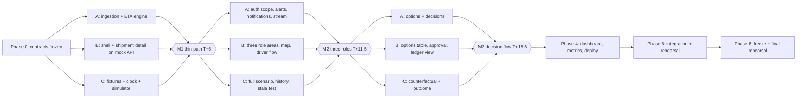

# PHASES.md — Execution plan for the Order-to-Delivery Control Tower (PS3)

Status: **DRAFT for team review**. This plan implements `DESIGN.md`. Section numbers such as "D§6.6" refer to that document; [p.N] refers to the hackathon PDF. If the two documents disagree, `DESIGN.md` wins and this file is corrected.

Implementation has **not** started. It starts only when the team lead says so.

---

## 1. Ground rules

| Item | Value |
|---|---|
| Time budget | 24 wall-clock hours from kickoff, written T+0 to T+24 (assumption A1 in D§0; rescale if wrong) |
| Reserved for integration and rehearsal | 6 hours (25%): phases 5 and 6 |
| Code freeze | T+21. After it, only fixes for defects found in rehearsal |
| Repositories (decision D5, approved; both private) | `control-tower-api`, `control-tower-web` |
| Branching | `main` always runs. Branches `feat/<area>-<name>`, merged by pull request with one review. Merge at least at the end of every phase |
| Definition of done for any task | Code merged to `main`, its test passes, and its exit criterion has been watched working by a second person |
| Coding agents | Each task brief given to an agent must cite the `DESIGN.md` section it implements. The owner reads and can explain what the agent wrote before merging [p.9, p.12]. Record agent use in `AI_USAGE.md` as you go |
| Rest | Not scheduled here. If the team rests, take it in turns after milestone M2 and use the cut list in section 6 to recover the time |

## 2. Owners

Names were not provided (open item O3). Replace the slots when known.

| Slot | Area | Repository and folders |
|---|---|---|
| **Owner A — API and domain** | Auth, event ingestion, state machine, ETA engine, alerts, options, decisions, notifications, stream | `control-tower-api/src/{auth,events,shipments,eta,alerts,options,decisions,notify,stream}` |
| **Owner B — Web** | All three role areas, map, driver phone layout, accessibility, generated API types | `control-tower-web` |
| **Owner C — Simulation, data and quality** | Fixtures, clock and replay simulator, counterfactual, dashboard and impact queries, integration tests, deployment, demo script and slides | `control-tower-api/{fixtures,src/sim,src/dashboard,test}`, deployment configuration in both repositories |

Owners A and C share one repository but not folders. The only shared file is the database schema (`migrations/`), which Owner A owns; Owner C requests changes through A.

## 3. Core requirements: owner and verification

| Core expectation [p.7] | Accountable owner | Supporting | Verified by | Verified in phase |
|---|---|---|---|---|
| C1 Separate logins for three roles | A | B | Test T6; three sign-ins watched | 2 |
| C2 Map tracking with status milestones | B | A, C | Test T4, T5; marker moves within 2 s on three screens | 2 |
| C3 ETA and delay risk with the reason | A | B | Test T1, T2, T7; worked example D§6.6 reproduced on screen | 1 (thin), 2 (full) |
| C4 Alerts to customer and coordinator with a suggested action | A | B, C | Test T2, T8, T9, T10 | 1 (alert), 3 (actions) |
| C5 Dashboard by route and transporter | C | B | Test T12 | 4 |

Test numbers are defined in D§10.2.

## 4. Critical path and parallel work

**Critical path:** contract freeze → ETA engine (A) → thin path M1 → alerts and scoped access (A) → option evaluator and decision service (A) → counterfactual outcome (C) → rehearsal. Owner A's tasks carry the most critical-path weight; if A is blocked, C pairs with A before doing anything else.

**Interface agreement points** (all three present, 15 minutes each, outcome committed to `DESIGN.md`):

| When | Agree on | Document section |
|---|---|---|
| T+0:30 | Endpoint list, event payloads, snapshot shape, error format, identifiers | D§5.1, 5.5, 5.7 |
| T+1:00 | Fixture file shapes and the `SHP-1001` numbers | D§6.6, 10.1 |
| T+6:00 (M1) | Stream hint shape; what the web app refetches on each hint | D§5.8 |
| T+11:30 (M2) | Option set and decision payloads; ledger outcome shape | D§5.7.3, 6.8 |
| T+15:30 (M3) | Dashboard and impact response shapes | D§5.5, 10.3 |

Between these points, a contract change needs a message to all three and a same-commit edit to `DESIGN.md`.

---

## 5. Phases

### Phase 0 — Foundations and contract freeze (T+0 to T+1.5)

**Objective:** everyone can run both repositories and build against a fixed contract.
**Owner:** all. **Depends on:** both repositories existing on GitHub.

| Task | Owner | Artifact |
|---|---|---|
| Create repositories, add `DESIGN.md`, `PHASES.md`, `AI_USAGE.md`, READMEs with links, `.env.example`, `.gitignore` | C | Two repositories with `main` |
| Scaffold API: Fastify, Zod, SQLite connection, migrations for all tables in D§5.2, `/health`, `/openapi.json` | A | Running API on port 4000 |
| Scaffold web: Vite, React, Router, Query, Tailwind, login page shell, mock API server built from the sample payloads in D§5.7 | B | Running web app on port 5173 against mocks |
| Write `config.json`, `users.json`, `customers.json`, `transporters.json`, `routes.json` with segments for `RTE-01` and `RTE-01B`; draw and check route geometry | C | Fixtures committed |
| Hold agreement points 1 and 2 | All | Contract sections confirmed |

**Exit criteria**
- `npm run dev` works in both repositories on all three machines (resolves open item O1).
- `GET /health` returns 200; the web app shows the login page.
- The sample payloads in D§5.7 validate against the API's Zod schemas (a test).

### Phase 1 — Thin path: event → changed ETA → visible alert (T+1.5 to T+6) — Milestone M1

**Objective:** one shipment event changes the ETA and an alert appears on screen, end to end, with real code on both sides.
**Depends on:** phase 0. **All three tasks run in parallel.**

| Task | Owner | Critical path | Artifact |
|---|---|---|---|
| `ingestEvent` with idempotency and ordering rules (D§5.6); state machine (D§5.3); `POST /shipments/:id/events`; `GET /shipments/:id` | A | Yes | Endpoints and tests T3, T4, T5 |
| `computeEta` pure function (D§6.3, 6.4) with unit tests for D§6.6 steps A and B | A | Yes | Test T1 (A, B) |
| Minimal alert: open on MEDIUM, escalate on HIGH, write notification rows (D§6.4) | A | Yes | Alert and notification rows |
| Login with one seeded coordinator (role policy comes in phase 2) | A | No | `POST /auth/login` |
| Shipment detail page: map with route and marker, ETA panel with factor list, alert banner; data by polling every 3 s for now | B | Yes | Page against the real API |
| Clock service (real and simulated), seed loader, simulator that moves `SHP-1001` along `RTE-01` by calling `ingestEvent`; `POST /demo/reset`, `/demo/scenarios/main/start`, `/demo/clock` | C | Yes | Replay runs |
| A temporary button on the detail page to post the D§5.7.1 disruption event | B | No | Removed in phase 2 |

**Exit criteria (watched by all three)**
1. Reset, start the replay: the marker moves on the map.
2. At 09:15 simulated time the ETA panel reads 11:45 with "slow traffic adds 25 min" and risk MEDIUM, with no human input.
3. Post the disruption: within 3 seconds the ETA reads 12:25, risk HIGH, an alert banner is visible, and the three factors sum to 175 minutes.
4. Posting the same event again changes nothing.
5. Tests T1 (A, B), T2 (coordinator part), T3, T4, T5 pass.

If M1 is not met by T+7, stop new work and all three work on it together.

### Phase 2 — Full three-role workflow (T+6 to T+11.5) — Milestone M2

**Objective:** three roles sign in, see only what they should, and share a live view.
**Depends on:** M1.

| Task | Owner | Critical path | Artifact |
|---|---|---|---|
| Role policy and `scopeFor` on every route; 404 and 403 rules (D§5.4, 9.1); audit events (D§9.4) | A | Yes | Test T6 |
| Notifications API; customer notified at HIGH; `BACK_ON_SCHEDULE`, `TRACKING_LOST` (D§8) | A | Yes | Test T2 complete |
| Stream hub and `GET /stream` (D§5.8) | A | No | Stream endpoint |
| Stale detection tick and confidence (D§6.5) | A | No | Test T7 |
| Role-based routing; coordinator attention queue with map; shipment list sorted by risk | B | Yes | Coordinator home |
| Driver trip screen in phone layout: milestone button, three-tap disruption report, outbox with retry (D§7.3, 5.6) | B | Yes | Driver screens |
| Customer "My deliveries" and delivery detail with "Why this ETA" (D§7.4) | B | Yes | Customer screens |
| Stream client with polling fallback; notification bell and toasts; all states in D§7.5 | B | No | Live updates |
| Full `scenario-main.json`: `SHP-1002` on `RTE-02` with barred alternative, `SHP-1003` planned; ground-truth speed profiles; `history.json` with 40 delivered shipments | C | Yes (for phase 3 and 4) | Fixtures |
| Integration test harness; tests T2, T6, T7, T13 | C | No | Passing tests |
| Coordinator demo control page wiring (reset, start, pause, speed) with B | C, B | No | `/coordinator/demo` |

**Exit criteria**
1. Three browser windows signed in as three roles; the customer sees only their own orders; test T6 passes.
2. The driver, on a phone-size screen, starts a trip and reports a disruption in three taps; coordinator and customer screens update within 2 seconds.
3. Customer screen shows the reason for the new ETA in plain words.
4. Pausing positions for 11 simulated minutes shows a greyed marker and Low confidence.
5. Two resets and replays give identical snapshots (T13).

### Phase 3 — Options, decision and ledger (T+11.5 to T+15.5) — Milestone M3

**Objective:** the coordinator compares options, approves one, everyone is informed, and the outcome is measured.
**Depends on:** M2, and agreement point 4.

| Task | Owner | Critical path | Artifact |
|---|---|---|---|
| Option evaluator: feasibility rules, projection by `computeEta` on hypothetical state, ranking, recommendation, no-improvement rule (D§6.7); `GET /alerts/:id/options` | A | Yes | Test T1 (C), T9 |
| Decision service: apply `REROUTE`, `RESCHEDULE`, `CONTINUE`, `SPLIT_SHIPMENT`; idempotent `decision_id`; `OPTIONS_STALE`; notifications to customer and driver (D§5.7.3) | A | Yes | Test T8, T10 |
| Options table with recommended and infeasible rows; approval dialog; stale-options handling (D§7.2) | B | Yes | Coordinator decision UI |
| Driver route-change banner; customer revised-ETA view; alternative route drawn dashed on the map | B | No | Role views |
| Ledger page (D§7.2) | B | No | `/coordinator/ledger` |
| Simulator follows the approved route; counterfactual run of the `CONTINUE` branch; outcome written on arrival (D§6.8) | C | Yes | Test T11 |
| Tune fixtures so replay reproduces D§6.6 step D exactly | C | Yes | Fixture values |

Implement `SPLIT_SHIPMENT` last within this phase. It is needed for completeness of core expectation C4's example but is not in the four-minute demo.

**Exit criteria**
1. For `SHP-1001` the options table matches D§6.6 step C: reroute 11:39, +16 km, ₹720, recommended; split unavailable with its reason.
2. Approving the reroute changes the route on the map, shows the driver banner, and gives the customer the 11:39 estimate, all within 2 seconds.
3. For `SHP-1002`, reroute is unavailable with the weight reason and the recommendation is to agree a new time.
4. After the replay reaches arrival, the ledger shows predicted 11:39, actual 11:43, counterfactual 12:40, 57 minutes avoided.
5. Tests T8, T9, T10, T11 pass.

### Phase 4 — Dashboard, metrics, remaining tests, deployment (T+15.5 to T+18)

**Objective:** core expectation C5 and the impact indicator are live; the app is reachable from a phone.
**Depends on:** M3 for impact figures; dashboard work can start from `history.json` at M2.

| Task | Owner | Artifact |
|---|---|---|
| Dashboard queries by route and transporter; delay-cause attribution; `GET /metrics/impact` (D§10.3) | C | Endpoints, test T12 |
| Dashboard page with charts and table alternative; impact panel | B | `/coordinator/dashboard` |
| Deploy API (one instance) and web; set environment variables; confirm the service does not sleep (open item O2) | C | Two public URLs |
| Accessibility pass on demo screens against D§7.6: keyboard run-through, contrast, live region, text alternative to the map | B | Checklist with results |
| Security pass against D§9.1–9.3: every route has a role list; no identifier taken from the client; no secrets in the repository or web bundle | A | Checklist with results |
| Optional feature 2 (proof of delivery) **only if** everything above is done by T+17 | A, B | Upload and download |

**Exit criteria**
1. Dashboard shows on-time % and delay-cause minutes by route and by transporter; totals match test T12.
2. After a replay, `SHP-1001` and `SHP-1002` appear in the dashboard figures.
3. The demo runs from the deployed URLs with the driver on a real phone.
4. All tests T1–T13 pass on `main`.

### Phase 5 — Integration hardening and rehearsal (T+18 to T+21)

**Objective:** the four-minute demo is boring to run.
**Owner:** all; C leads.

| Task | Owner | Artifact |
|---|---|---|
| Rehearsal 1 on deployed URLs with a stopwatch against D§10.5; log every hesitation and defect | All | Defect list |
| Fix defects, highest demo impact first | A, B | Fixes merged |
| Playwright script that walks the demo path (if time allows) | C | Script |
| Rehearse the failure case in D§10.6 and the local fallback in D§4.9 | C | Both watched working |
| Slides: problem and focus user; architecture diagram (D§4.1); where AI is and is not used (D§6.9); impact indicator with calculation and assumptions (D§10.3); controls (D§9.6); assumptions and pilot (D§11); AI declaration | C | Slide deck |
| Cross-explanation: each person explains another's area for five minutes using D§11 | All | Everyone can answer [p.12] |
| Rehearsal 2, full ten minutes with timed sections [p.10] | All | Timing sheet |

**Exit criteria**
1. Two consecutive clean runs of the demo inside 4:00.
2. Reset to ready state takes under 10 seconds.
3. Code freeze at T+21: `main` tagged `demo-freeze`.

### Phase 6 — Freeze, final rehearsal and buffer (T+21 to T+24)

**Objective:** arrive at the session with a working demo and no surprises.

| Task | Owner | Artifact |
|---|---|---|
| Rehearsal 3 on the presentation machine and network | All | Clean run |
| Final checklist from the brief [p.12], item by item | C | Completed checklist |
| `AI_USAGE.md` final; assumptions list final | A | Committed |
| Warm the deployed API 10 minutes before the session; sign in all three windows; reset | B | Ready state |
| Remaining time is buffer. No new features | — | — |

**Exit criteria**
1. Third consecutive clean run.
2. Every item on page 12's checklist is ticked with evidence.
3. Local fallback is running on the presenter's laptop before the session starts.

---

## 6. Cut list (drop from the top first)

Dropping any item on this list leaves all five core expectations working.

| Order | Item | Saves | What is lost |
|---|---|---|---|
| 1 | Optional feature 3: "Where is my order?" assistant | 2.5 h | A bonus item |
| 2 | Optional feature 2: proof of delivery upload | 1.5 h | A bonus item |
| 3 | Playwright demo script | 1 h | Automated demo check; manual rehearsal remains |
| 4 | Ledger page as a separate screen (show the outcome card on the shipment detail instead) | 1 h | A dedicated view |
| 5 | Hosted deployment (run locally, driver in phone-size window) | 1.5 h | A real phone in the demo |
| 6 | Server-sent events (keep 3-second polling) | 1.5 h | Sub-second updates; the "within 2 s" acceptance criteria relax to 3 s |
| 7 | `BACK_ON_SCHEDULE` and `TRACKING_LOST` notifications | 0.5 h | Two notification kinds; stale display remains |
| 8 | `SPLIT_SHIPMENT` execution (keep it as an evaluated option shown with feasibility; `REROUTE`, `RESCHEDULE`, `CONTINUE` remain approvable) | 1.5 h | One action type |
| 9 | Counterfactual simulation (ledger shows predicted against actual only) | 2 h | The "delay avoided" figure becomes a modeled estimate; this weakens the signature feature, so cut it last |

Never cut: the five core expectations, server-side access checks, the reset, the worked-example tests, or rehearsal time.

## 7. Risks to the plan

| Risk | Signal | Response |
|---|---|---|
| ETA engine numbers do not match the worked example | T1 failing at T+4 | C pairs with A; the example in D§6.6 is the specification, fix code not the example |
| Contract drift between repositories | Web types fail to generate, or a 422 in integration | Stop; run `npm run sync:api`; fix at the next agreement point |
| Simulator and human steps fall out of sync in the demo | Replay passes a beat before the presenter acts | Auto-pause at each beat (D§10.4) |
| Owner A overloaded | A's phase tasks unfinished at a milestone | C takes notifications, stream or audit; apply cut list items 6 and 7 |
| Agent-written code nobody understands | Owner cannot explain a file at review | Do not merge; simplify or rewrite. Undeclared or unexplained work is a scoring risk [p.9] |
| Hosted service sleeps or fails | Slow first request in rehearsal | Warm-up step in phase 6; local fallback ready |

## 8. Open items carried from DESIGN.md

A1 (meaning of 24 hours), O1 (SQLite driver), O2 (hosting provider), O3 (team names), O4 (missing score-level slides). See D§12.
